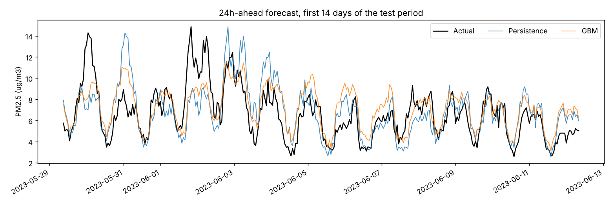
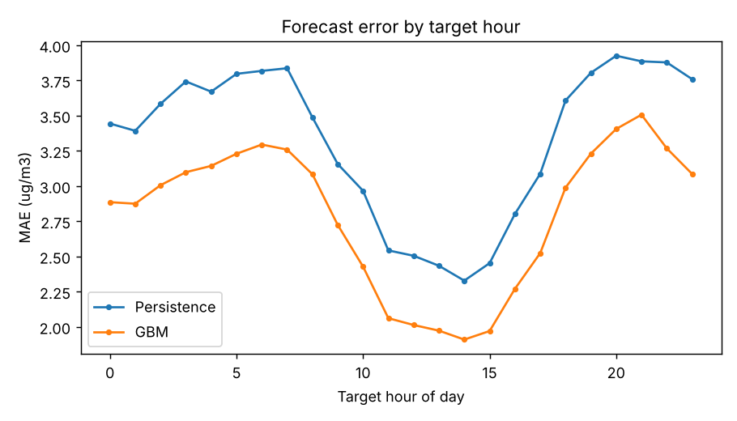

# Air Quality Forecasting: 24-hour-ahead PM2.5

Forecast hourly PM2.5 one day ahead and convert it to AQI categories, comparing a persistence baseline, a ridge model and lag-feature gradient boosting on a synthetic multi-year series.

## Problem statement

Given the hourly history up to time *t* (PM2.5 and weather), predict PM2.5 at *t + 24 h*, and the resulting AQI category (Good / Moderate / USG / Unhealthy / Very Unhealthy / Hazardous). The task is evaluated with a strictly chronological hold-out.

## Highlights

All numbers below are copied from `reports/metrics.json` (held-out test period starting 2023-05-28 09:00:00, 5199 hourly samples).

- Gradient boosting reduces MAE from 3.33 (persistence) to 2.80 ug/m3, a 15.9% improvement; RMSE 5.29 -> 4.78.
- AQI category accuracy: 0.788 (persistence) -> 0.829 (GBM); within one category 0.998.
- The simple ridge baseline reaches essentially the same MAE as GBM (2.80); GBM is better on RMSE and R2 only. The gain over persistence comes mostly from the linear/seasonal structure, not from non-linear modelling.
- Rare high-pollution alerts (USG or worse, 1.7% of test hours) remain hard: persistence has the best alert F1 (0.465) versus 0.245 for GBM.

## Data

The data are **synthetic**, not real measurements. `src/airq/data.py` generates 17520 hourly rows (two years from 2022-01-01) with a fixed seed: a log-scale PM2.5 process with winter-heavy seasonality, diurnal traffic peaks and afternoon dilution, a weekend effect, dependence on wind, boundary-layer height, humidity and pressure, multi-day stagnation episodes (ground-truth flag stored in the `episode` column and used only for error analysis, never as a feature), AR(1) noise and short sensor gaps (1.5% of PM2.5 values missing). The generated file is committed as `data/air_quality_hourly.csv` (about 1 MB). Because the generating process is known and fairly smooth, results will not transfer to real monitoring data.

## Project structure

```
config.yaml            seed, split, lags, CV grid, paths
data/                  generated sample CSV
src/airq/data.py       generator, loader, causal gap filling
src/airq/features.py   lag/rolling/weather/calendar features, AQI categories, time split
src/airq/train.py      models, time-series CV, model saving
src/airq/evaluate.py   metrics and plots
src/airq/predict.py    forecast CLI (python -m airq.predict, with PYTHONPATH=src)
scripts/run_pipeline.py  data -> train -> evaluate -> reports
tests/                 unittest suite
reports/               metrics.json and figures/
models/                saved joblib model (git-ignored)
```

## Quickstart

```
pip install -r requirements.txt
python scripts/run_pipeline.py          # about 15-20 s on a laptop CPU
python -m unittest discover -s tests -v
PYTHONPATH=src python -m airq.predict --last 6
```

`make install`, `make train`, `make test` wrap the same commands.

## Methodology

- Target: PM2.5 at t+24 h. Features at row t use data up to t only: PM2.5 now, lags (1, 2, 3, 6, 12, 24, 48, 168 h), rolling mean/std (6, 24, 72 h), 24 h max, 3 h change, current weather, 24 h mean wind, 6 h pressure change, 24 h temperature change, and calendar terms (hour, weekend) of the target time, which are known in advance. Short PM2.5 gaps are forward-filled (causal).
- Split: last 30% of the timeline is the test set; the final 24 training rows are purged because their targets fall in the test period.
- Models: persistence (forecast = current value); ridge on log1p(PM2.5); HistGradientBoosting trained on the log-scale residual relative to persistence.
- Model selection: expanding-window `TimeSeriesSplit` (4 folds, 24 h gap) over the training period only, on a small grid; selected params: {'learning_rate': 0.03, 'max_iter': 300, 'max_leaf_nodes': 6, 'min_samples_leaf': 150, 'l2_regularization': 5.0, 'loss': 'absolute_error'}. CV MAE 3.30 +/- 0.95.
- Categories use US-EPA-style PM2.5 breakpoints (12.0, 35.4, 55.4, 150.4, 250.4). The USG-or-worse alert F1 treats categories >= USG as positive.

## Results

| Model | MAE | RMSE | R2 | Category acc. | Within 1 cat. | Alert F1 (USG+) |
|---|---|---|---|---|---|---|
| Persistence | 3.33 | 5.29 | 0.476 | 0.788 | 0.999 | 0.465 |
| Ridge (log) | 2.80 | 4.96 | 0.539 | 0.834 | 0.998 | 0.023 |
| GBM (log) | 2.80 | 4.78 | 0.573 | 0.829 | 0.998 | 0.245 |

MAE (ug/m3) by regime on the test set:

| Model | Non-episode hours | Episode hours | PM2.5 >= 35.5 |
|---|---|---|---|
| Persistence | 2.86 | 12.04 | 17.03 |
| Ridge (log) | 2.16 | 14.67 | 24.84 |
| GBM (log) | 2.24 | 13.12 | 22.12 |

Top permutation-importance features (increase in log-scale MAE when shuffled):

- `pm_mean24`: 0.0087
- `pm_lag168`: 0.0020
- `pm_now`: 0.0019
- `pm_lag48`: 0.0017
- `pm_mean72`: 0.0017

Figures: [forecast window](reports/figures/forecast_window.png), [predicted vs actual](reports/figures/scatter_pred_vs_actual.png), [GBM confusion matrix](reports/figures/confusion_gbm.png), [persistence confusion matrix](reports/figures/confusion_persistence.png), [feature importance](reports/figures/feature_importance.png), [MAE by target hour](reports/figures/mae_by_hour.png).




## Limitations & future work

- Synthetic data: conclusions about model ranking and absolute errors do not carry over to real stations.
- Only one hold-out period (Jun-Dec) and one seed; CV fold variance is large relative to the differences between models.
- Models under-predict high-pollution episodes (episode-hour MAE is far above non-episode MAE), so alert recall is poor; persistence is better there. Quantile or classification-focused objectives, and forecast weather inputs instead of observed weather at time t, would be natural next steps.
- Two years of data is too short to learn an annual cycle reliably; day-of-year features were removed after they hurt held-out error.
- No multi-horizon or probabilistic forecasts.

## Using a real dataset

A suitable choice is the UCI "Beijing Multi-Site Air-Quality Data" (or the Kaggle "Beijing PM2.5 Data"). Build a frame indexed by timestamp with these columns: `pm25` <- PM2.5, `temp_c` <- TEMP, `wind_ms` <- WSPM, `humidity` <- derive from DEWP and TEMP, `pressure_hpa` <- PRES, `blh_m` <- not available (drop it from `WEATHER` in `features.py` or substitute another variable). The pipeline also reads an `episode` 0/1 column for error analysis; set it to 0 if unavailable. Save it as CSV and point `data.sample_path` in `config.yaml` to it.

## License

MIT, see `LICENSE`.
